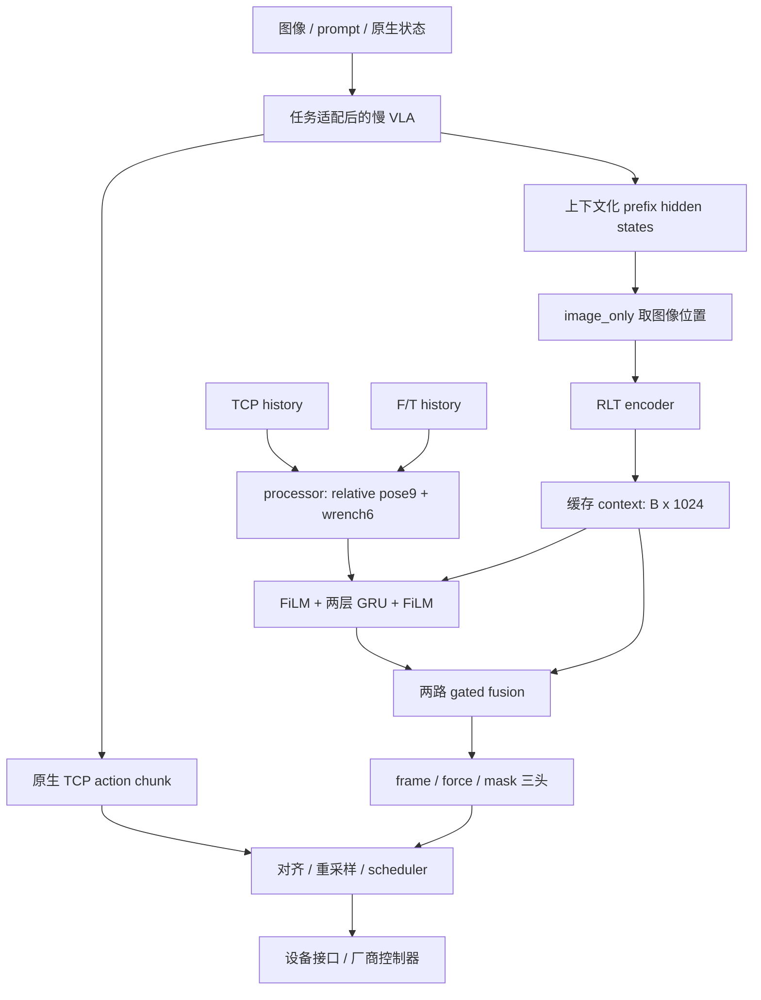

# FP2 源码精读：从 π0.5 到 peg-in-hole 的张量、训练与执行

更新：2026-11-09。接 [3c：论文 tensor 推导](03c_fp2_tensor_walkthrough.md)，配 [第14课](14_force_aware_adaptation.md)、[面试练习册](vla_interview_workbook.md)；坐标与控制基础见 [3b](03b_fp2_adaptor_twist_wrench.md)。

本篇将 Ai2 的 [架构与训练笔记](../../../JOB/interview/Ai2_interview/09_fp2_architecture_and_training.md) 同步为本课程的源码学习材料，并定向复核对应实现。案例选 `peg_togethertrained_pi05_rlt1024_100k_fp2_20k_deploy.yaml` 引用的 **RLT1024、无快策略独立 wrist encoder、无快动作头** 配置。配置名不证明训练步数、成功运行或本人使用过哪个最终 checkpoint。

证据分三层：**论文系统、所选源码配置、教学推演**。本次只读源码：HEAD 为 `f020bd5d514d6148e389ca9e14b008854bf3a3f0`，工作树有未提交修改；Ai2 09 记录的20个源文件摘要均与本次一致，见 [来源快照](../resources/fp2_source_snapshot_2026-11-09.json)。没有加载权重、训练、执行推理或连接机器人。其他 backbone/变体不能照抄本例尺寸。

## 怎么循序学习

| 单元 | 本次解决的问题 | 对应章节 | 闭卷产出 |
|---|---|---|---|
| D1 | 慢模型输出谁，compressor读取谁？ | §1–3 | 双支路图与Q/K/V来源 |
| D2 | 哪个loss更新哪些参数？ | §4–5 | 训练阶段和反向梯度图 |
| D3 | 快策略每个tensor怎么变化？ | §6–8 | 1024→FiLM/GRU→gate→三头的shape表 |
| D4 | 未来标签、时序和实验如何解释？ | §9–12 | 单步标签手算、频率表、归因对照 |

建议每次45–75分钟，是学习预算；无需在本地安装源码依赖。先完成手算和阅读，再按需使用既有Colab toy。D编号只用于本篇，不改变VLA、ML、RL课程编号。

## 1. 一张图区分两条支路



Compressor本身不读实时force；force进入快策略的history支路。RLT是上下文瓶颈的命名，当前训练是重建学习，不能据此称为reinforcement learning。

本例保留VLA运动生成，用快策略输出交互参数。源代码也支持wrist和action-head消融，故“FP2没有腕部输入/动作头”必须限定为所选基线。上游VLA仍可读取wrist图像；没有独立快视觉encoder不等于没有视觉信息。

## 2. RLT实际读取的context是什么

`vla_adapter/openpi_adapter/pi0_integration.py::extract_prefix_embeddings` 的顺序是：

```text
preprocess observation
  → embed_prefix（图像、文本等prefix位置）
  → prefix attention / positions
  → PaliGemma.llm，得到prefix_out
  → image_only=True后切取图像位置
  → C [B,N,2048]
```

因此C是**经过VLM上下文化后的图像位置hidden states**，不是原始RGB，也不是刚出image encoder的patch embeddings。切掉文本位置，不表示这些图像位置从未读取文本；要看上游attention依赖。

不能由两台物理相机直接断言N=512。图像槽位、缺失图像处理和上游模型配置决定实际序列；extractor的图像块约定、fake observation推断与真实batch都要核对。不同backbone可能从其他位置读取feature：GR00T与LaWAM各有自己的adapter。

## 3. Learned-query compressor的逐轴变化

本例K=1、d=1024、D=2048。此处K是瓶颈token数，不能与执行horizon混用。

```text
C                                  [B,N,2048]
input_proj                         [B,N,1024]
加可学习context position parameters [B,N,1024]
learned q_embed，batch广播          [B,1,1024]
多层CrossAttentionLayer             [B,1,1024]
encode输出Z                         [B,1,1024]
提取/缓存时flatten                  [B,1024]
force-policy obs slot               [B,1,1024]，_encode中squeeze
```

`q_embed`是可学习参数，使用sinusoidal initializer；初始化形式不意味着训练时固定。各层query从前层瓶颈表示而来，K/V来自context；不是用wrench构造query。

若按标准8-head等宽attention展开，d_h=128：

```text
Q                  [B,8,1,128]
K,V                [B,8,N,128]
scores / weights   [B,8,1,N]，softmax沿N
多头聚合并还原      [B,1,1024]
```

这是核心attention的shape推演；完整block的残差、归一化、前馈由导入的`CrossAttentionLayer`实现，本轮没有重新审计其全部依赖。

重建decoder用N个learned queries读取Z，再投影回2048维，得到`[B,N,2048]`。在线只调用encode。`2×512`和`1×1024` flatten后都为1024个数，但query数、attention与decoder读出不同，不能视为同一模型。

## 4. 重建目标、mask和真正的冻结

所读OpenPI/JAX `RLTokenModel.loss` 使用**重建MSE**。它与论文中的MSE+cosine、以及通用PyTorch compressor中可选cosine项分别记录，不能跨实现互相代替。

模型类支持masked MSE；但本trainer实际调用：

```python
prefix_embs, prefix_mask = extract_prefix_embeddings(..., image_only=True)
prefix = jax.lax.stop_gradient(prefix_embs)
rlt_loss, info = rlt_module(prefix.astype(jnp.float32), None, train=train)
```

上面省略其他实参，突出梯度和mask。真实调用给mask传`None`，因此不能声称该trainer已按prefix_mask排除全部无效token。缺失相机场景须核对token处理约定。

设重建为`decoder(encoder(C))`，仅把目标写为`stop_gradient(C)`，仍然存在：

```text
C → encoder → decoder → loss
```

这条输入梯度。外层trainer先截断prefix输入梯度，再限制optimizer参数，才构成完整冻结证据。

| `rlt_alpha` | 实际训练路径 | 更新参数 |
|---|---|---|
| 0 | prefix-only；L=MSE reconstruction | 仅`rlt_module`，VLA冻结 |
| >0 | 额外计算VLA action loss；L=L_rec+alpha·L_VLA | filter允许全部nnx.Param；VLA可经action loss更新，重建输入仍stop-gradient |

“允许全部参数更新”不表示每个参数每一步都必有非零梯度。函数存在也不意味着某个实验启用了它；必须记录实际alpha。

## 5. Task fine-tuning、RLT训练与force训练分别做什么

```text
预训练RFM
  → 原生task adaptation（LoRA或full，先核对实际配置）
  → 任务适配后的RFM checkpoint
      ├→ 单独部署：baseline
      └→ RLT训练 → 离线token提取 → force-policy训练 → 联合部署
```

论文基准的阶段2/3冻结关系，不能覆盖源码中显式提供的alpha>0联合训练分支。离线token一旦写入，force-policy训练只读取缓存feature；该路径不会反传穿过文件去更新RFM/RLT。

LoRA学习低秩增量；full直接优化上游配置选中的原模型参数。两者都是任务适配，“训练FP2时冻结”描述后续阶段。当前peg配置/YAML名不能单独证明最终run的完整fine-tuning recipe。

Flow方向也按代码区分：本地integration采用

$$
X_t=t\epsilon+(1-t)A,\qquad U_t=\epsilon-A.
$$

t=1为noise，t=0为data；采样若沿同一ODE应使用负步长。第9课noise→data采用另一套自洽符号，不能只搬target的正负号。alpha=0的RLT训练不计算action flow loss。

## 6. Processor：原始量怎样成为模型输入

| 量 | 原始/物理表示 | 本例处理后 |
|---|---|---|
| context | encoder的`[B,1,1024]` | `vision_feat`槽传入；模型squeeze为`[B,1024]` |
| TCP history | `[B,100,7]`，base中xyz+wxyz quaternion | 相对aux TCP，xyz+rotation6D，`[B,100,9]` |
| aux TCP | `[B,1,7]` | 窗口参考pose |
| measured wrench | `[B,100,6]`，各时刻TCP表达 | 归一化`[B,100,6]` |

TCP相对平移范围为±0.3m，wrench平移力±50N、力矩±5N·m，线性映射到±1。当前normalize/unnormalize只做仿射变换，不自动clamp。预测值1.4可被映射成70N，不能把“归一化范围”当硬件限幅。

F/T配置的src/target frame相同，`rotation_only=True`；不能说已将所有历史wrench搬到最新TCP原点。改变参考点需要力矩的平移项；公式与符号见3b。

## 7. FiLM、GRU与gate：不同于compressor cross-attention

```text
proprio9 + wrench6                    [B,100,15]
input FiLM，context为条件             [B,100,128]
两层GRU，hidden=128                   [B,100,128]
output FiLM，取末时刻 aggregate=True  [B,128]
与原context分别投影                  两路 [B,128]
concat后gate网络                     [B,2]，softmax沿两路source
加权和 + LayerNorm                   [B,128]
```

FiLM是feature-wise linear modulation。本例公式为：

$$
h=\operatorname{LN}(Wx+b),\quad
[\gamma(z),\beta(z)]=W_fz+b_f,
$$

$$
y=\operatorname{Mish}\big((1+\gamma(z))\odot h+\beta(z)\big).
$$

gamma/beta均为`[B,128]`，在history轴广播成`[B,1,128]`。同一z调制100个点，不表示每个点都重新调用VLA。

GRU递归处理窗口，当前调用没有把上一轮的hidden state作为下一轮输入，故不能声称有跨整个episode的无限记忆。取末时刻之前仍编码了前面窗口信息。

Fusion将history feature与context分别经Linear/LayerNorm/GELU投到128维，再由拼接向量算gate：

$$
\tilde h_p=P_p(h_p),\quad \tilde h_z=P_z(z),\quad
g=\operatorname{softmax}(G([\tilde h_p;\tilde h_z])),
$$

$$
h_f=\operatorname{LN}(g_1\tilde h_p+g_2\tilde h_z).
$$

这是**两路gated fusion**。源码另支持`CrossAttnFusion`，不能因为compressor用了cross-attention，就说所选快策略融合也用cross-attention；gate大小也不等于因果重要性。

## 8. 三个独立MLP头、loss与物理输出

三个头共享fusion feature，各自经过`128→128→64→output`，中间用LayerNorm/Mish。

| 头 | 网络输出 | 监督 | 推理处理 |
|---|---|---|---|
| force | `[B,1,6]` | L1 | 反归一化为期望wrench，N/N·m |
| frame | `[B,1,9]` | L1 | xyz+rotation6D转为TCP-relative xyz+wxyz，`[B,1,7]` |
| mask | `[B,1,6]` logits | BCEWithLogits | sigmoid后以0.5阈值转bool |

$$
L_F=L_{frame}+L_{force}+0.1L_{mask}.
$$

本例确实有9+6+6=21个raw预测值；它们来自独立头，不是一个可直接下发的21D机器人action。`switch_signal`由mask派生，不是第四个学习头。基线loss没有action项。

有动作头的消融会增加50步pose head；有wrist的消融会增加独立视觉支路。设备接口还会清除mask后三个旋转轴，故“模型预测六轴mask”不等于实际启用六轴力/力矩控制。需要分别记录raw mask、switch、执行mask。

## 9. 50个未来标签为何只监督一个输出

`get_one_step_reference_gt`从未来frame/force/mask序列重组一个交互参考。令`c[j]`表示第j个标签是否有任一控力轴：

| 状态 | 判定 | 选择什么标签 |
|---|---|---|
| 保持接触 | c[0]=1，且不满足will_release | future offset指向的标签 |
| 即将接触 | c[0]=0，前40条中存在接触 | 首次接触位置+future offset |
| 即将释放或没有接触 | 其他情况 | zero wrench/mask、identity-like frame |

本例`pre_contact=40`、`pre_release=40`、`release_rho=.9`、`future offset=0`；超出序列的索引clamp到末项。`c[0]=1`且前40条接触比例严格小于.9才触发will_release。

数据标签目标50Hz、`remove_first=True`，相对最近匹配的锚点，第一项通常为+20ms，前40项约覆盖+20至+800ms。因此代码中的“current”是标签第0项，不能不加说明地当作观测瞬间。

**手算：** 35/40=.875，会释放；36/40=.9不满足严格小于，不会因该条件释放。若c[0]=0、c[10]=1，则可选首次接触标签。未来标签是离线监督，不是在线知道未来或真实接触已经被确认。

这次核对的是标签消费/单步重组逻辑，未审计peg原始frame/mask标注生成的全过程。不能用FP1的labeler替代当前数据来源证明。

## 10. 缓存、时钟与控制接口

| 所选源码配置/逻辑 | 含义 | 不应直接推断 |
|---|---|---|
| source/sync 15Hz | 原生动作waypoint与对齐网格；离线token也可15Hz | VLA每秒推理15次 |
| planner/fast目标50Hz | 两个循环的目标周期20ms | 已测得硬实时50Hz |
| TCP采集50Hz、F/T轮询200Hz | Python buffer采集与重采样 | 底层传感器/伺服带宽 |
| history100点@50Hz | 首末跨度99/50=1.98s | 100个独立VLA context |
| max_infer_dt=.5s | 距上次slow完成后何时再次请求，队列也可触发 | 实测固定2Hz或超时abort |
| SDK/论文1kHz口径 | 需另外核对设备/实验版本 | Python线程已实现1kHz反馈 |

论文III-D描述quintic spline重采样与内部1kHz控制律；所读peg YAML选择linear位置插值+姿态SLERP。源码中的`interp_continuous_dynamics`仍转调linear，不能根据名字宣称实现了五次样条。此前“1kHz插值输出”的用户实现口径另保留为历史说明，不替代当前代码的50Hz planner证据。

当前执行层保留VLA position queue，按预测mask与持续信号防抖决定发送路径。快bundle可hold last，但当前所读结构没有显式TTL；队列耗尽时本分支不发新命令，不足以证明机器人已停止或卸力。

RLT与position queue分步更新、无共同generation ID，是需用日志验证的版本一致性风险；这里是静态发现，不是已复现故障。更多细节参考 Ai2 [部署笔记](../../../JOB/interview/Ai2_interview/10_fp2_runtime_and_control.md)。

## 11. 如何区分FP2、数据与任务微调的收益

应从同一个任务适配checkpoint分出baseline与+FP2路径，记录demonstration/split/训练预算/controller/测试初态。这样比较增量，不把预训练模型到任务微调的收益一起算给FP2。

“相同demonstrations”不代表“相同信息与监督”：FP2使用wrench、结构标签和实时反馈。baseline对比衡量整套交互调节系统；要定位压缩器、反馈或架构的贡献，还需匹配force-aware baselines和内部消融。

论文Table I标的是`π0 (LoRA)`与`π0.5 (full)`，不能读成同一个π0.5的两种微调方法。论文的SR/CR混合平均、成功rollout条件下的NFE，分别保留原定义；不能把静态源码或yaml命名当新的成功率证据。

| 消融 | 必须控制与检查 |
|---|---|
| RLT vs global_mean | 读取位置、相机块、输入维数可能同时变化 |
| 1×1024 vs 2×512 | flatten长度相同，query结构不同 |
| no-wrist vs wrist | 上游视觉仍存在；快支路计算、外观依赖和预算变化 |
| no-action vs action head | 快路径能否改变TCP目标；不能再把收益全称作纯力控 |
| token-only / history-only | 去掉了什么条件，按任务与接触阶段分层 |
| context age / force delay | 离线新鲜token与在线缓存分布是否匹配 |

## 12. 源码阅读与闭卷验收

源码相对路径基于`Noematrix/fp2` checkout；课程内容不依赖它才能阅读，具体绝对来源与SHA256见快照。

| 顺序 | 路径 | 验证的问题 |
|---|---|---|
| 1 | `configs/policy/flip_fp2_rlt1024_no_wrist.py`、`_flip_fp2_base.py` | 1024/100/128/三头来自哪项配置？ |
| 2 | `vla_adapter/openpi_adapter/pi0_integration.py`、`model.py` | image_only在上下文化前还是后？Q/K/V及MSE？ |
| 3 | `vla_adapter/openpi_adapter/train_rlt.py` | stop-gradient、alpha与optimizer filter？ |
| 4 | `configs/processor/flip_fp2.py` | frame、rotation、范围与反归一化？ |
| 5 | `policy/common/seq_encoder.py`、`film.py` | 时间窗口、FiLM广播与aggregate？ |
| 6 | `policy/force_policy2/fusion.py`、`force_policy.py` | gate、heads、labels与loss？ |
| 7 | `runner/fp2_policy.py`、`slow_fast_scheduler.py`、`robot_interface.py` | physical output、时效和执行轴？ |

合上书回答：

1. 把`[B,N,2048]→[B,1,1024]→[B,1024]`每一步的操作和训练参数说清。
2. 画context的两条快策略路径：FiLM条件，以及独立fusion source。
3. 为什么只stop-gradient target不等于冻结？alpha>0又更新谁？
4. 为什么100×15没有展平成1500维直接进入MLP？GRU是否跨调用保留hidden？
5. 为什么21个raw输出会成为6D wrench、7D pose、bool mask，而不是21D动作？
6. normalized force=1.4、35/40接触、raw旋转mask为true时，各自要追哪一层？
7. 说清哪项是论文事实、哪项是所选源码、哪项仍需训练日志或真机验证。

Colab继续使用 [ML05](../labs/notebooks/ML05_attention_compressor.ipynb) 理解learned-query/冻结、[VLA02](../labs/notebooks/VLA02_multirate_force_execution.ipynb) 理解多速率。ML05的GRU+concat toy不是本例FiLM+gating实现；两者均不加载真实FP2或证明机器人性能。
