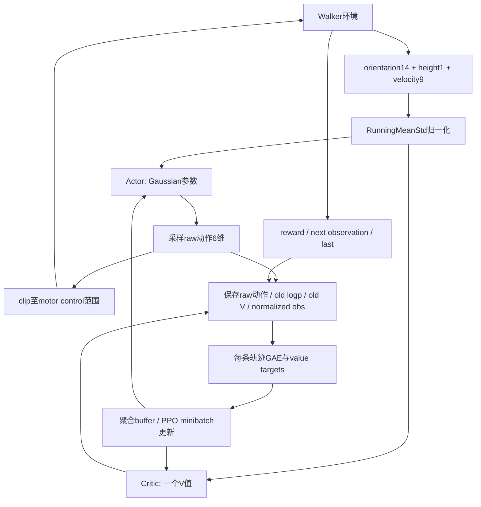

# R7D：用你的 DM Control Walker 项目读懂 PPO

[RL目录](README.md) · [R6 GAE](06_actor_critic_and_gae.md) · [R7 PPO](07_ppo.md) · [R8 SAC](08_continuous_control_and_sac.md) · [Colab RL02](notebooks/RL02_walker_ppo_tensor_trace.ipynb)

更新：2026-11-09。这一课用你课程项目的 `hw4/walker.py` 串起观测、连续动作、Gaussian policy、GAE和PPO更新。先把“24维输入、6维输出”讲成一条有物理含义的数据流，再连接公式；无需重读全部RL课程。

**证据：** 本次只读你的源码，299行，SHA256=`77bb604e9b57dbb68cd064a60296810357b3367405a61e54f05cebd2f1c00d92`，仓库HEAD=`bb3c2dc27ad54419d26472410bb32cee85393fa7`，该文件无未提交修改。源位置与本课入口见文末。环境语义另核对当前DM Control官方源码；这不恢复你当时的依赖版本。本次不重跑Walker训练。

## 先按四步学，而不是从loss开始背

| 单元 | 本次只讲清什么 | 留下的证据 |
|---|---|---|
| W1，约30–40分钟 | 24个输入与6个动作到底是什么 | 索引/物理意义表，解释为什么不是24DoF |
| W2，约30–45分钟 | actor、std、critic和log-prob的shape | 手画24→256→256→6/1，推一次联合概率 |
| W3，约30–45分钟 | transition怎样变成advantage/return | 三步GAE、timeout与terminal反例 |
| W4，约30–45分钟 | buffer怎样完成一轮PPO更新 | 算5000条数据的minibatch数，做项目口述 |

时间是学习预算。先W1/W2再看RL02前半；读R6/R7后补W3/W4。不清楚return或V时，只回查R1/R2；不需要先学完SAC。

## 1. 你的项目到底在解决什么问题

环境是 `suite.load('walker', 'walk')`：一个平面双腿机器人通过六个motor controls维持站立并向前行走。你补的是策略与价值网络、采集/GAE/buffer/PPO训练流程，环境和作业骨架来自课程。



这里reward来自环境，不需要专家action标签；critic在训练中提供估值，执行时actor可独立输出动作。你的viewer使用actor均值并clip，与训练采样不同。

## 2. 24维更准确地叫observation，而不是24个状态自由度

源码按以下顺序拼接：

```text
o[0:14]  = observation['orientations']
o[14]    = observation['height']
o[15:24] = observation['velocity']
14 + 1 + 9 = 24
```

`24`是输入特征长度，不表示机器人有24个关节或独立自由度。它也不是完整MuJoCo内部state的直接拷贝。

### 2.1 orientations为什么是14

当前官方`orientations()`从非world bodies的旋转矩阵取`xx/xz`两个分量并展平。模型有7个这样的body，每个两个数：

| observation索引 | body | 存的量 |
|---|---|---|
| 0–1 | torso | body旋转矩阵的xx/xz |
| 2–3 | right_thigh | 同上 |
| 4–5 | right_leg | 同上 |
| 6–7 | right_foot | 同上 |
| 8–9 | left_thigh | 同上 |
| 10–11 | left_leg | 同上 |
| 12–13 | left_foot | 同上 |

它们是无量纲的平面姿态表示，类似用正余弦型分量表达朝向；不能说是14个原始joint angles。六个腿关节会共同影响这些body的姿态，躯干姿态也单独被表示。

角度只有一个自由度却可用两个数表达，所以“特征数”与“物理自由度”可以不同。表示中的冗余不等于多出一个可控制关节。

### 2.2 height和9维velocity

`o[14]`是torso高度，单位m。`velocity()`返回广义速度qvel；按当前官方XML中的joint顺序：

| observation索引 | 广义速度 | 单位 |
|---|---|---|
| 15 | rootz：根部竖直平移速度 | m/s |
| 16 | rootx：根部水平平移速度 | m/s |
| 17 | rooty：平面内根部转动速度 | rad/s |
| 18–20 | right hip/knee/ankle速度 | rad/s |
| 21–23 | left hip/knee/ankle速度 | rad/s |

也就是3个根部速度+6个腿关节速度。根部3个自由度没有对应motor，不能因为qvel为9维就把动作也设为9维。

上述字段由 [官方Walker](https://github.com/google-deepmind/dm_control/blob/main/dm_control/suite/walker.py)、[模型XML](https://github.com/google-deepmind/dm_control/blob/main/dm_control/suite/walker.xml) 和 [Physics.velocity](https://github.com/google-deepmind/dm_control/blob/main/dm_control/mujoco/engine.py) 交叉核对。复现历史运行时还需打印当时版本的spec/named indices。

**检查题：** 将actor输入从24改成9是否只是“去掉冗余”？不是。输入内容已变成另一种observation design，丢失了高度与朝向等特征；要重新明确字段并做任务对照。

## 3. 六维动作是什么：左右腿各三个motor

| action索引 | actuator |
|---|---|
| 0 | right hip |
| 1 | right knee |
| 2 | right ankle |
| 3 | left hip |
| 4 | left knee |
| 5 | left ankle |

代码从`action_spec().shape[0]`得到6，并将执行值限制在[-1,1]。这是六个motor的连续control输入，不是TCP的六维pose，也不是六个关节位置目标。

当前XML的motor gear按每腿hip/knee/ankle分别为100/50/20。Control通过执行器模型及传动作用到关节，所以不能把数值0.5直接解释成0.5rad或0.5N·m。简单motor直连hinge时，关节作用还要计入gear；最终语义见 [MuJoCo actuation model](https://mujoco.readthedocs.io/en/stable/computation/index.html#actuation-model)。

**为什么六个动作仍能控制整个身体运动？** 腿部驱动通过接触地面与身体耦合影响根部状态；PPO学的是这种闭环行为。它并未给根部三个自由度分别下达位置命令。

**三种“维度”先分开：** observation24、actuator action6、hidden width256。它们分别来自特征接口、控制接口和网络设计。

## 4. 你的actor输出六维均值，但策略还需要六维std

源码`uth_t`是：

```text
normalized observation        [B,24]
Linear(24,256) + Tanh         [B,256]
Linear(256,256) + Tanh        [B,256]
Linear(256,6)                 [B,6] = mu

独立可学习log_std参数         [6]
exp并广播                     [B,6] = std
sample                        [B,6] = raw action
```

因此可以说“actor的均值网络最后输出6维，整个Gaussian policy由mu和std共同定义”。它不是12个actuators，也不是只要mu就完整定义训练时的随机策略。

$$
\pi_\theta(u\mid o)=\prod_{j=1}^{6}
\mathcal N\big(u_j;\mu_{\theta,j}(\tilde o),\sigma_j^2\big),
\qquad \sigma=\exp(\mathrm{log\_std}).
$$

本项目`log_std`初始化为-0.5，初始std约0.60653。它是`nn.Parameter`并进入optimizer。`fixed_var=True`在这份代码中表示**state-independent的共享std参数**，不表示方差永远冻结。

固定一次网络权重时，两个不同observation可以得到不同mu，但使用同一组std；训练更新后这组std也可改变。代码中的`fixed_var=False`分支未实现，不能声称已支持state-dependent std。

Actor末层是Linear，输出没有经过tanh限幅；隐藏层的Tanh与SAC的tanh-squashed action不是一回事。

## 5. Critic为什么只输出一个数

`vth_t`是一套独立的`24→256→256→1` Tanh MLP：

$$
V_\phi(\tilde o_t)\approx
\mathbb E_\pi\left[\sum_{k\ge0}\gamma^k r_{t+k}\mid\tilde o_t\right].
$$

它估计当前策略从这个观测继续走下去的折扣回报，是标量，不为六个motor各打一个分。它也不是即时reward或成功概率，数值不必在[0,1]。

```text
收集单步：obs [1,24] → value [1,1] → 存成标量
更新batch：obs [B,24] → value [B,1] → squeeze(-1) [B]
target return                              [B]
```

两个网络放在同一个Adam里，不等于共享trunk。Actor loss训练策略，value loss训练critic；old values与targets在更新前固定。

**广播反例：** `[256,1] - [256]`可能广播成`[256,256]`，制造错误的样本两两误差。源码使用`.squeeze()`；教学建议写`.squeeze(-1)`，避免B=1时顺便丢掉batch轴。

## 6. Normalization：输入网络的到底是哪24个数

每个原始特征按在线统计量变换：

$$
\tilde o_j=(o_j-\mu_j)/\sqrt{v_j+10^{-8}}.
$$

Shape仍为24，物理输入字段保持原顺序；进入网络的值已变为统计尺度。Raw m、rad/s与无量纲姿态的差异不会通过reshape自动解决。

你的代码先更新running stats再normalize，并把**采集时真正输入actor的normalized observation**保存进buffer。更新时直接复用它，避免用后来变化的统计量重新归一化同一条原始记录，改变old/new policy的比较条件。

RunningMeanStd在源码注释中标明有Gemini辅助；面试应解释其作用和集成，不把辅助代码说成完全独立手写。实际训练seed也不完整：环境使用RandomState(42)，但最终脚本没有统一固定NumPy采样与PyTorch随机源。

## 7. 为什么六维log-prob最后要合成一个标量

每条transition只有一个联合动作，六维对角Gaussian的联合log-density为：

$$
\log\pi_\theta(u_t\mid o_t)
=\sum_{j=1}^{6}\log\mathcal N(u_{t,j};\mu_j,\sigma_j^2).
$$

```text
dist.log_prob(raw_action)   [B,6]
sum(dim=-1)                [B]
old_log_prob               [B]
ratio=exp(new-old)         [B]
advantage                  [B]
```

假设每维log-prob都为-0.7，联合log-prob是-4.2。若六维各自的密度比均为1.01，联合ratio是`1.01**6≈1.06152`，不是把六个ratio取平均得到1.01。

这些是连续分布的density。精确采到某个实数向量的概率为零，不能把density当离散事件概率；log-density本身也不保证为负。

## 8. Raw action与clip后的执行动作为什么都要讲

源码逻辑为：

```text
u_raw ~ Normal(mu,std)
old_logp = log_prob(u_raw).sum(-1)
u_env = clip(u_raw,-1,1)
env.step(u_env)
buffer保存u_raw和old_logp
更新时重新计算log_prob(u_raw)
```

例如raw=`[1.3,-1.2,.2,0,.7,-.4]`，实际执行`[1,-1,.2,0,.7,-.4]`。当前实现保存raw动作，因此不能误报“它把raw的old logp与clipped的new logp混用了”。

这相当于把clip看作策略之后的固定执行映射；原始Gaussian与clipped action分布仍是不同对象。很多raw值可映射到同一个边界值，饱和可能影响探索和学习效率。若改为tanh-squashed policy，要重新处理变换后的log-density，不只是给当前代码加一行tanh。

项目中三种clip：action clip限制执行范围，PPO clip作用于ratio surrogate，grad norm clip作用于反向梯度。它们约束的对象完全不同。

## 9. 一条轨迹变成GAE：reward来自哪里

你的最终脚本直接使用环境reward，没有额外reward scaling。按当前官方环境，reward综合站立高度、直立程度和向前速度；`walk`与`run`目标不同，不能混报。环境reward由任务定义，你负责学习与训练流程，不应说这些奖励全由你从头设计。

对同一条轨迹：

$$
\delta_t=r_t+\gamma V_{next}-V_{old}(\tilde o_t),
\quad \hat A_t=\delta_t+\gamma\lambda\hat A_{t+1},
\quad \hat R_t=\hat A_t+V_{old}(\tilde o_t).
$$

本项目gamma=.99、lambda=.95，先按每条trajectory反推，再把结果写入buffer，没有先打乱多回合再跨episode计算GAE。

**按项目系数手算：** rewards=`[1,1,1]`，old values=`[.5,.6,.7]`，末端是外部timeout，bootstrap V=.8。

```text
delta2 = 1 + .99*.8 - .7 = 1.092
delta1 = 1 + .99*.7 - .6 = 1.093
delta0 = 1 + .99*.6 - .5 = 1.094

A2 = 1.092
A1 = 1.093 + .9405*A2 = 2.120026
A0 = 1.094 + .9405*A1 = 3.087884453
targets R = [3.587884453, 2.720026, 1.792]
```

这些value targets不是直接把当前reward当标签；它们包含后续奖励与bootstrap估值。

### Timeout与真正terminal必须分开

源码把`step==T-1`或`r_step.last()`都标为timeout并bootstrap。标准Walker主要按时间限制结束时有合理性，但迁移到“摔倒立即终止/碰撞失败/真正任务终止”的环境不能照抄：真正terminal应令续接value为0。

同上例若末端是真正terminal，则delta2=.3，A0=2.387328575，target R0=2.887328575。两种边界计算结果不同。

原实现每条trajectory单独GAE，所以无需把reset后的下一回合接进来；一般并行buffer的两个mask处理见R6C。新环境还要核对discount、terminated、truncated与final observation。

## 10. 4096不是神经网络维度，也不总是实际batch长度

代码每次收集一整条至多1000步的trajectory，加入buffer；长度达到4096才更新。

```text
1000 → 2000 → 3000 → 4000 → 5000，触发update
```

若每条都恰好1000步，一次update实际M=5000：

| tensor | shape |
|---|---|
| normalized observations | `[5000,24]` |
| raw actions | `[5000,6]` |
| old logp / old value / raw advantage / value targets | 各`[5000]` |
| 一个完整minibatch的mu/std | `[256,6]` |
| 一个完整minibatch的new logp/ratio/advantage | 各`[256]` |
| critic输出 | `[256,1]`，只去掉末轴变`[256]` |

每epoch `ceil(5000/256)=20`个minibatches，其中19批256、最后136。10 epochs合计200次optimizer steps。**5000次环境决策、1轮PPO更新、200次优化器步**是三种计数。

源码先对整个buffer的advantage标准化，再shuffle做minibatch更新。4096只是触发门槛，256是minibatch，24/6是输入输出接口，256同时也恰好是隐藏宽度；同一个数字的两个角色要分开。

## 11. 用自己的PPO update解释“模型如何学会走路”

$$
\rho_t=\exp(\log\pi_\theta(u_t\mid\tilde o_t)-\log\pi_{old}(u_t\mid\tilde o_t)),
$$

$$
L_\pi=-\operatorname{mean}\min(\rho_t\hat A_t,
\operatorname{clip}(\rho_t,.8,1.2)\hat A_t),
\quad L_V=\operatorname{mean}(V_\phi-\hat R)^2,
$$

$$
L=L_\pi+0.5L_V.
$$

“好于当前baseline的动作提高相对密度、差于baseline的动作降低相对密度”是理解入口，具体梯度还取决于clip/min与advantage符号。每次更新重新评价**已采到的raw动作**，不是重新采一组动作来算ratio。

流程：收集后固定old logp/targets → 10次shuffle遍历 → backward → actor/critic联合grad norm clipping .5 → Adam.step → 清空buffer → 用新策略收集。Actor和critic各有独立参数，优化器把它们放在同一个参数列表。

当前版本的实际选择：Adam初始3e-4、按环境step线性衰减并设下限1e-5；无entropy bonus、KL early stop或value clipping。不要把R7的通用可选项自动说成项目已实现。[PPO原始说明](https://spinningup.openai.com/en/latest/algorithms/ppo.html)

**重要反例：** advantage均值为0时，初始ratio=1可能使actor loss数值接近0，但其对参数的梯度仍可非零。标量loss恰为0不代表policy没有更新。

## 12. 交互时间、2M和900+如何准确表达

| 数字 | 它在项目中的含义 | 不能替代什么 |
|---|---|---|
| T=1000 | 单条rollout最多1000个环境决策步 | 1000次optimizer update |
| 2,000,000 | 目标环境交互步预算，按len(traj)累计 | 物理积分步、成功次数、优化器步 |
| 900+ | 既有项目材料报告观察过的训练episode return | 独立多seed评估均值、成功率 |

当前官方默认control timestep=.025s，即40Hz决策；physics timestep=.0025s，通常每决策10个积分子步；25s时限约1000次决策。它们用于解释时间尺度，不是恢复当时运行环境的版本证明。

900/1000可理解为该完整episode平均即时reward约.9，但不能从一个高回合推断稳定性。你的训练使用随机action，viewer使用clip后的mu且不更新normalizer；评估方式不同也需说明。

当前脚本保存学习曲线图，没有checkpoint/normalizer持久化或resume，未包含独立多seed评估。应把“看到了高训练回报”与“已完成可重复部署评估”分别陈述。

## 13. 把RL正课都挂到这个项目上

| RL概念 | 在你项目里问自己 | 对应课 |
|---|---|---|
| observation / action / reward / return | 24、6、即时reward、episode return分别是什么？ | R1 |
| V与baseline | critic的一个输出为什么不是六个动作评分？ | R2/R5 |
| TD / bootstrap | timeout的最后.8怎样改变target？ | R3/R6 |
| stochastic policy | 六维mu和可学习std怎样采样？ | R5 |
| GAE | 一条trajectory怎样反向累积delta？ | R6 |
| PPO / on-policy | 为何同批可做10 epochs，但下一轮仍采新数据？ | R7 |
| SAC对照 | replay、Q、entropy和有界动作处理会改什么？ | R8，作为方案对照，非已实现 |
| reward / dynamics | 环境的任务目标是否等于只追求速度？ | R9 |
| offline / IL | 当前是在线交互，并非从专家动作标签学习 | R10 |
| 评价 / 系统 | 环境seed、训练seed、episode数、normalizer如何记录？ | R11 |

这样复习时，每个公式先落到Walker的一条transition，再讨论其他机器人。FP2的监督力控不能因此改称PPO；算法学习信号仍须逐模块确认。

## 14. 面试短答与追问

**中文首答：** 我在课程提供的DM Control Walker环境与骨架上补齐PPO训练流程。输入是14维身体姿态特征、1维躯干高度和9维广义速度，共24维observation；动作是左右腿六个motor controls。Actor输出六维Gaussian均值，另有六维可学习的state-independent log-std；critic单独估计一个V值。采集时保存normalized obs、raw action、old logp和value，每条轨迹算GAE，再聚合buffer做clipped PPO minibatch更新。项目材料报告过900+训练回合回报，但它不是多seed独立评估均值，也没有真机部署。

**英文练习：**

> My policy takes a 24-dimensional observation: 14 body-orientation features, torso height, and nine generalized velocities. It controls six leg motors. The actor predicts a six-dimensional Gaussian mean with a learned, state-independent standard deviation, while a separate critic estimates a scalar value. I implemented rollout bookkeeping, GAE, and clipped PPO updates on top of the course starter structure.

关卷回答，先独立写再核对本课：

1. 为什么14个orientation数不是14个关节角？7个body各取两个旋转矩阵分量。
2. 9维velocity为什么只有6个actions？3个根部自由度未直接驱动。
3. “输出六维”是否漏掉std？动作六维，分布由mu/std共同定义，std来自独立参数。
4. `fixed_var=True`到底固定了什么？输入依赖形式固定为state-independent，参数仍训练。
5. log-prob为什么sum？一条样本评价六维联合动作，不是六个独立PPO样本。
6. 三种clip有什么区别？执行动作、surrogate ratio、参数梯度分别处理。
7. 4096/256/10怎么算优化次数？按真实buffer长度；5000条时为200步。
8. `last()`是否总该bootstrap？原项目这样做，新环境必须分true terminal与timeout。
9. 你是否写了环境、用了entropy、做过多seed？分别按starter、最终loss和实际证据回答。

## 15. Colab与来源

[RL02](notebooks/RL02_walker_ppo_tensor_trace.ipynb) 用合成24维字段和同形状actor/critic，检查6维Gaussian、raw/clipped动作、log-prob、GAE和一次minibatch更新。**不创建MuJoCo环境，不训练步态**；代码自包含，只上传一份notebook即可。本次仅生成/静态检查，未执行torch或Colab。

源码路径：`/Users/junjianhu/Repositories/Penn Repo/ese650-learning-in-robotics-coding-repo/hw4/walker.py`。既有完整项目审查是 [NIO Walker复盘](../../../../JOB/interview/NIO_interview/ppo_walker_implementation_review.md)；本课将它改写为可循序学习的RL项目课，不修改课程项目或JOB目录。

完成后在 [进度](progress.md) 分别记录W1–W4解释与本人Colab运行；来源版本、normalizer与模型若不一致，应重新核对，而不据本课尺寸盲目拼接。
