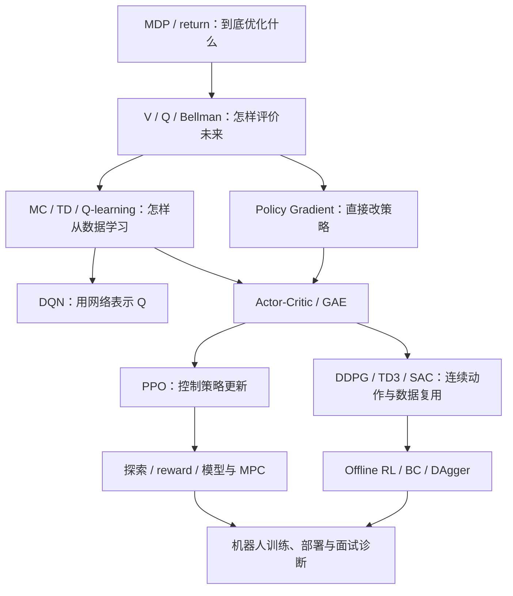

# Reinforcement Learning：面试复习专题

建立日期：2026-10-25。与 [ML 专题 M1–M10](../ml_interview/README.md) 并列，采用独立 **R1–R11** 编号。仓库实际目录是 `robot_learning/notes/`；本专题承接主线第 16/17 课的 RL 内容，MPC 作为连接控制的补充，不代表主线所有后续课程已经完成。

**2026-11-09，先接到你自己的项目：[R7D：DM Walker项目课](07d_dm_walker_project.md)。** 先用W1/W2弄清24维observation、6维motor controls与actor/critic；需要补概念时沿下表回到R1–R7，之后再完成W3/W4的GAE和完整更新。R1–R11的理论课号保留。

第一次系统学RL仍可从 [R1A](01_mdp_and_return.md) 开始；现在各课末尾有“用你的Walker项目对照”，让公式落到同一条真实数据流上。SAC/offline等内容明确作为后续设计对照，不说成你的PPO项目已经实现。

## 复习地图

| 课 | 三个小单元 | 学完必须能做 | 优先级 |
|---|---|---|---|
| [R1：MDP 与 return](01_mdp_and_return.md) | A 交互与状态；B 折扣回报；C RL/BC | 给机器人任务定义 MDP，算一条轨迹回报 | P0 |
| [R2：价值与 Bellman](02_value_and_bellman.md) | A V/Q/A；B 期望/最优方程；C DP | 手算一步 backup，分清 evaluation/control | P0 |
| [R3：MC、TD 与表格控制](03_mc_td_and_q_learning.md) | A MC/TD；B SARSA/Q-learning；C n-step/mask | 写 target，区分采样策略与目标策略 | P0 |
| [R4：DQN](04_dqn_and_stability.md) | A 网络与 loss；B replay/target；C Double/dueling/PER | 画出 target/gradient，定位发散原因 | P1 |
| [R5：Policy Gradient](05_policy_gradient.md) | A 轨迹概率；B REINFORCE；C baseline | 推出 log-prob 梯度，解释为何不需要环境可导 | P0 |
| [R6：Actor-Critic 与 GAE](06_actor_critic_and_gae.md) | A actor/critic；B GAE；C tensor/边界 | 手算 advantage，区分 bootstrap 与递推 mask | P0 |
| [R7：PPO](07_ppo.md) | A ratio/clip；B 训练循环；C KL/故障 | 算正负 advantage 的裁剪，解释 clip 的局限 | P0 |
| [R7D：你的DM Walker项目](07d_dm_walker_project.md) | W1 24/6物理接口；W2 Gaussian与V；W3 GAE；W4完整update | 读自己的源码、推tensor、算5000条数据的更新次数；[RL02 Colab](notebooks/RL02_walker_ppo_tensor_trace.ipynb) | 项目主线 |
| [R8：DDPG、TD3 与 SAC](08_continuous_control_and_sac.md) | A deterministic actor；B TD3；C entropy/SAC | 写 SAC target 和 actor loss，比 PPO/SAC | P0 |
| [R9：探索、奖励与模型](09_exploration_reward_and_models.md) | A exploration；B shaping；C model-based/MPC | 识别 reward hacking，解释模型误差与时域 | P1 |
| [R10：Offline RL 与模仿](10_offline_rl_and_imitation.md) | A BC/DAgger；B support/OOD；C CQL/IQL | 用小反例解释离线 Q 的外推问题 | P0 |
| [R11：机器人与训练诊断](11_robotics_and_diagnostics.md) | A 接口/控制；B 仿真迁移；C 评价/故障 | 设计实验、说清个人工作和证据范围 | P0 |

P0 是本专题建议先练的基础，不是任何公司的真实题频统计。另有 [33 道面试题与参考要点](interview_drill.md)、[公式与算法对照](cheatsheet.md)、[学习记录](progress.md)、[原始资料](resources.md)。

## 每次怎么学

每个 A/B/C 单元先按 30–45 分钟预算：5 分钟回忆 → 10–15 分钟读直觉/推导 → 10 分钟手算 → 5–10 分钟口述和纠错。这是个人学习预算，不是实验测得的耗时。11 课共 33 个单元约 17–25 小时；实验和综合复盘另留时间，按掌握情况调整。

验收要留下三样东西：**一个不查笔记的解释、一个算对的例子、一个能识别的错误。** 不会时只补当前缺口，不从头重刷 ML。

若临近面试，可先用三次集中复习建立主干：

1. R1–R3：return → Bellman → TD；题卡 Q01–Q09。
2. R5–R7：policy gradient → advantage → PPO；题卡 Q13–Q21。
3. R8、R10、R11：SAC、离线数据与机器人系统；题卡 Q22–Q24、Q28–Q33。R4/R9 按追问补。

每次至少留 2–3 小时；这是压缩路线，只覆盖核心机制，完整推导和实验仍按单元继续。

## 第一个代码实验

[RL01：两状态 MDP、Bellman 与 TD](notebooks/RL01_tabular_foundations.ipynb) 是一份自包含 notebook：Python 标准库、合成小环境、不需要下载数据或配置本地环境。上传单个文件到 Colab，从头运行；R1 先看回报，R2 看 Bellman，R3 再看采样更新。

当前仅准备代码并做静态检查，**未执行 notebook，也未在 Colab 验证运行**。运行后填写 [学习记录](progress.md)。小环境的结果只解释表格 RL，不证明 PPO/SAC 或真实机器人效果。

项目配套 [RL02：Walker PPO tensor trace](notebooks/RL02_walker_ppo_tensor_trace.ipynb) 可单独上传Colab，使用合成24维字段和同尺寸actor/critic，打印mu/std/value/log-prob/ratio，并做一次合成minibatch更新。它不安装或创建dm_control，不训练Walker步态；本次只生成/静态检查，未执行。学习者无需运行 [文件生成器](tools/build_walker_notebook.py)。

## 符号与约定

统一写 $s_t,a_t,r_t,s_{t+1}$：$r_t$ 是执行 $a_t$ 后得到的奖励。Sutton & Barto 常把同一个奖励写作 $R_{t+1}$，只是下标不同。$G_t=\sum_{k\geq0}\gamma^k r_{t+k}$；$\pi$ 为策略，$V^\pi/Q^\pi$ 为该策略的价值，$A^\pi=Q^\pi-V^\pi$。

理论先假设 fully observed MDP；机器人通常只有 observation $o_t$，history/RNN 并不自动保证充分状态。真实终止后 continuation value 为 0；外部截断仍可能需要 bootstrap。详细约定见 R1/R3/R6。

与已有材料互查：[ML 概率与目标](../ml_interview/01_probability_and_objectives.md)、[ML tensor/backprop](../ml_interview/04_tensors_and_backprop.md)、[动作与控制接口](../13_action_and_control_interfaces.md)、[BC 概率推导](../04_probabilistic_bc_and_training.md)。
