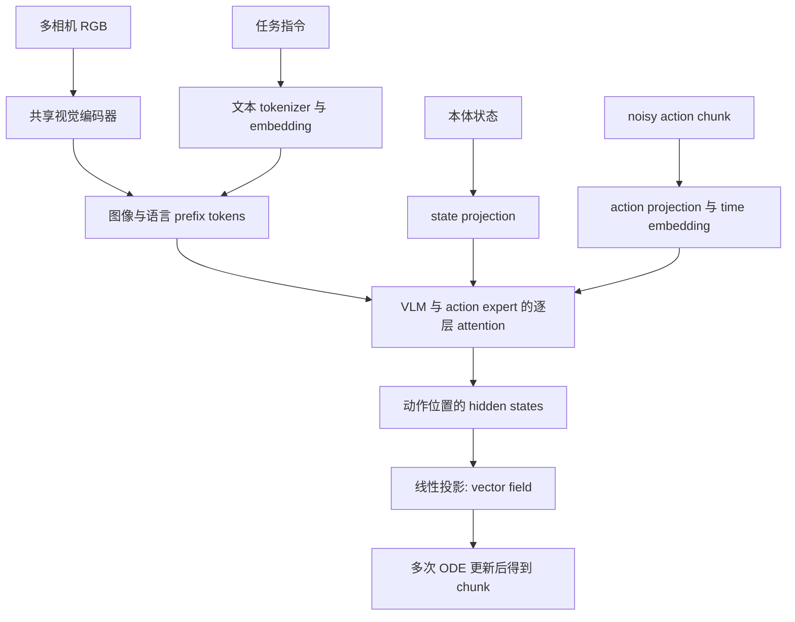

# P1：π0 的完整架构——语义条件怎样进入连续动作

返回 [专题入口](README.md)。主读：[本地 π0 v1](../../../paper/2410.24164v1.pdf) §III–V、附录 B/D；评估回看 §VI 和附录 E。

本课要达到：从相机、语言和关节状态一路讲到动作 chunk，说明每个 tensor、每条 attention 边和 cache 的有效范围。

## 1. 先把论文贡献说完整

π0 是基于预训练 VLM 的通用机器人策略，通过一个较小的 action expert，用 conditional flow matching 生成连续 action chunk。它同时研究跨机器人数据预训练和任务数据 post-training。

因此它有三部分贡献：**架构、数据与训练配方、真实机器人评估**。只说“VLM 后接 flow head”会漏掉动作专家如何与 VLM 交互，以及预训练如何影响新任务适应。

论文 v1 §V/§VII 报告约 10,000 小时自有机器人数据、7 类配置、68 个任务，再结合开放机器人数据。这是该版本的实验背景，不代表复现必须拥有同等规模，也不代表相同数量的任务具有相同难度。

## 2. 策略接口：先写概率问题，再画网络

本专题统一记：

$$
c_t=(I_t^1,\ldots,I_t^{N_c},\ell_t,q_t),\qquad
A_t=[a_t,\ldots,a_{t+N_a-1}],
$$

$$
\pi_\theta(A_t\mid c_t),\qquad A_t\in\mathbb R^{N_a\times d_a}.
$$

$q_t$ 是机器人本体状态，不是环境的完整 Markov state。$d_a$ 的物理含义由 embodiment 决定。π0 v1 使用 50 个动作的 chunk；它不表示未来 50 秒，也不要求执行完 50 个动作才更新。

同样的形状 `[B,50,14]` 可以表示双臂关节位置，也可以是另一种接口。必须补齐单位、absolute/delta、joint/Cartesian、gripper 定义和采样间隔。

## 3. 从 VLM 到 action expert

依据 π0 v1 §IV、附录 B：VLM 从 PaliGemma 初始化，action expert 从随机权重初始化，约 300M 参数。图文 tokens 与 state/action tokens 使用不同权重，并在 Transformer attention 中交互。

这里的 expert 不是根据任务由一个 learned router 任意选择的稀疏 MoE：token 类型决定使用哪组参数。也不能把它画成只在最后一层接收一个 VLM 向量的普通 MLP。

预训练不自动意味着冻结。π0 的 VLM 初始化、下游 fine-tuning 的冻结配置，以及 FP2 中冻结 task-adapted RFM，是三个不同决定。

## 4. 把 token、embedding 和 shape 分清

“token”在论文里也指连续序列位置。一个 action token 可以是一个时刻的连续动作 embedding，无需先变成词表里的整数。

以下是**教学 shape 示例**，不是某机器人固定配置：batch 为 2、3 个相机、每相机 $N_v$ 个视觉 tokens、文本长度 32、模型动作维度 32。

| 量 | 形状 | 意义 |
|---|---|---|
| 单相机图像 | `[2,224,224,3]` | 图像大小取决于 preprocessing |
| 图文 prefix | `[2,3*N_v+32,d_v]` | VLM hidden width |
| state | `[2,32]` | 对齐/补齐后的本体状态 |
| state token | `[2,1,d_e]` | action expert 的线性投影 |
| clean/noisy actions | `[2,50,32]` | 每个序列位置含一条完整动作向量 |
| action embeddings | `[2,50,d_e]` | 加入生成时间条件后进入专家 |
| predicted velocity | `[2,50,32]` | 单位是 normalized action / flow time |

π0 v1 附录 B 的 VLM hidden width 为 2048，action expert 为 1024。两者不必同宽，因为可通过各自投影进入可兼容的 attention 表示，再映射回各自 residual stream。面试时应说明需要哪些维度兼容，不必背诵全部配置数字。

**32 是公开代码的默认模型维度，不能用它反推真实机器人有 32 个 DoF。** π0 v1 §V-A 的数据 padding 维度为 18；对应版本和配置必须明确。

## 5. Attention 的最小数学桥梁

对一个 expert 的 hidden sequence $X$：

$$
Q=XW_Q,\quad K=XW_K,\quad V=XW_V,
$$

$$
\operatorname{Attn}(Q,K,V)
=\operatorname{softmax}\left(\frac{QK^\top}{\sqrt{d_k}}+M\right)V.
$$

$M_{ij}=0$ 允许 query $i$ 读 key $j$；禁止时用 $-\infty$。**行是读取者，列是信息源**。多头 attention 让模型在不同子空间聚合信息，随后投影回 residual stream。

若两组 tokens 有不同 hidden width，可各自生成 attention 的 Q/K/V，再按 mask 交互。不要把“不同 expert 权重”误解成“完全互相隔离”。

## 6. π0 的三块 mask

π0 v1 附录 B 将序列分为：

- $P$：图像和语言；
- $S$：当前 state token；
- $A$：整个 noisy action chunk。

允许关系为：

| Query \ Key | P | S | A |
|---|---:|---:|---:|
| P | 1 | 0 | 0 |
| S | 1 | 1 | 0 |
| A | 1 | 1 | 1 |

每块内部是双向 attention，块之间沿条件到动作的方向流动。

**为什么动作块能双向？** 这些是同时生成的 noisy action 变量，不是部署时偷看的未来传感器。训练的 flow target 只在 loss 中出现；只要没有从 clean future action/force 进入条件的泄漏，联合建模整个未来动作 chunk 是合法的。

**为什么 prefix 不能读 action？** 若 prefix hidden states 依赖当前 noisy action，下一次 ODE step 改了 action 后，旧 prefix 的 K/V 就失效。block mask 使条件表示可复用，也减少图文预训练接口的分布变化。

这与 [第 3 课](../03_slow_fast_contact_policy.md) 防止 future-force leakage 的目的不同：一个限制可生成变量与条件的依赖，一个限制尚未发生的观测进入策略。

## 7. Cache 究竟省了什么

一次 observation 固定时，图像编码、图文 prefix 的 K/V 不必每个 ODE step 重算。action embeddings 随 noisy chunk 和生成时间变化，因此需迭代计算。

论文附录 B 还说明 state block 可缓存；固定版本公开实现的 `sample_actions` 则先缓存图文 prefix，并在 suffix 中处理 state/action。**理论上可缓存的量与这份实现实际缓存的量要分别回答**，见 [P5](05_openpi_engineering.md)。

同一 chunk 的 ODE steps 复用 context，并不等于后续所有 chunk 都能用同一 cache。相机、prompt 或 π0.5 的 tokenized state 变了，需要更新相应条件表示。缓存旧 context 并不能让 policy 获得新视觉反馈。

## 8. 模型时间与控制时间

π0 v1 附录 D：10 次 Euler 更新产生 50 个动作。20 Hz 的 UR5e/Franka 每执行 16 个动作重新查询；50 Hz 平台每执行 25 个动作重新查询，分别对应约 0.8 s 和 0.5 s 的执行窗口。

因此 50 Hz command stream 不表示每 20 ms 重跑 VLM。ODE 的第 5 步也不表示机器人已执行了第 5 个动作。

论文 Table I 在 RTX 4090、3 相机条件下给出 73 ms on-board inference：图像编码 14 ms、observation pass 32 ms、10 次 action pass 合计 27 ms。它是特定实现与硬件的测量，不能作为本机或任意部署的延迟保证。

## 9. 训练配方与结果该怎样读

π0 v1 §V-A 将较广的数据用于 pre-training，以覆盖多样状态、任务和恢复行为，再用更高质量的目标任务示范 post-train。文中 task-robot 组合按 $n^{0.43}$ 调整采样权重，说明数据权重不等于原始时长占比。

§VI 的四组问题分别是：base policy 表现、语言跟随、新任务 fine-tuning、复杂多阶段任务。它们的训练条件不同，不能把它们合成一个“通用零样本成功率”。

特别注意：

1. base evaluation 中的 “zero-shot” 是**没有额外 post-training**；一些任务本身就在 pre-training 中。
2. 许多图报告的是部分完成可得分的 normalized score，不是 episode 全成功率；附录 E 给出 rubric。
3. π0-small 除 VLM 初始化外，规模和架构也不同，所以比较不能严格隔离“仅有 VLM 预训练”的因果效应。
4. “compute parity”主要控制训练更新数量，不自动使 FLOPs、容量和数据暴露量全部相等。

这些限制不否定结果，而是帮助你准确说明证据支持到哪里。

## 10. 练习与验收

1. 不看论文画三块 mask，解释为什么把 `P→A` 打开会破坏 cache。
2. 对 `[B,50,32]` 的 velocity 写出 action projection、expert、output projection 前后的 shape。
3. 50 Hz、每次执行 25 个动作，计算重规划频率；再解释 10 个 flow steps 为什么不进入这个除法。
4. “π0 只在 VLM 后接了一个动作 MLP”漏掉了哪些结构？
5. “模型使用 state，所以已经实现接触闭环”错在哪里？

核对：第 3 题为 2 Hz；第 5 题需继续检查 force 输入、反馈频率、chunk 执行和低层控制器，不能只看 observation 字段。

英文口述：

> Walk through pi-zero from multi-camera observations and language to a continuous action chunk. Explain token routing, the attention mask, and what can be cached during sampling.

通过标准：5 分钟讲完整条路径，并清楚区分 paper v1、教学 shape 与代码默认配置。下一课：[P2：Flow Matching](02_flow_matching.md)。
