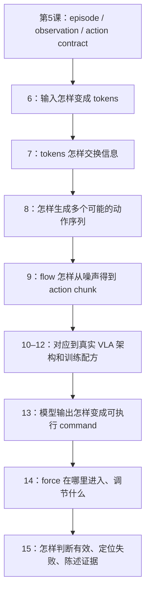

# VLA 正课学习路线：从第 5 课走到系统理解与面试表达

当前入口：**6A，先理解一个 observation 怎样变成 token。** 第 6–15 课是主线；ML 的 M1–M10 用于查缺口，Pi 的 P1–P6 在第 11/12 课深入阅读。已经读完 ML 题型，不要求重新通刷。

本路线把十课拆成 **30 个学习单元（6A–15C）**。课号保持不变，单元不是新增三十篇论文。每次只完成一个小问题，并留下自己的推导、图或解释。材料已准备与本人已经掌握分别记录在 [进度](progress.md)。

## 1. 先看清整条链

贯穿练习采用一个教学任务：机器人根据语言找到指定物体，靠近表面并维持接触。用它理解数据流；本仓库的随机 tensor、单维生成分布和 spring 实验并不构成这个任务的完整机器人实现。



| 阶段 | 课程 | 学完后独立完成的事 | 面试能力 |
|---|---|---|---|
| 表示与信息流 | 6–7 | 从 RGB 画到 attention 输出；判断信息能否被读取 | 解释架构、手算 shape、查 leakage |
| 动作分布与生成 | 8–9 | 分开训练图、采样图和执行时间 | 推导 loss、比较 head、解释采样 |
| 真实模型映射 | 10–12 | 按同一张接口表比较模型并追源码 | 论文理解、设计取舍、训练系统 |
| 执行与接触 | 13–14 | 讲清 units/frame/time 和 force 数据流 | 部署诊断、FP2 项目深挖 |
| 评价与证据 | 15 | 提出可检验的假设、对照与失败解释 | 实验设计、项目陈述、追问应答 |

先建立这五层之间的关系，再记模型名称。面试中能够沿箭头解释“输入是什么、输出是什么、为什么这样变”，比只复述模型亮点更容易应对追问。

## 2. 每个单元怎样学

建议每单元预留 **45–75 分钟**；这是学习预算估计，不是必须赶完的期限。一次 60 分钟可以这样分配：

| 时间 | 动作 | 留下什么 |
|---|---|---|
| 5 分钟 | 合上笔记，复述上次的输入和输出 | 一个没有查答案的版本 |
| 20 分钟 | 只读当前小节，先讲直觉，再补公式 | 一张图或 3–5 句因果解释 |
| 10 分钟 | 用给定小数字手算 tensor / loss / 时间 | 可核对的中间步骤 |
| 15 分钟 | 对照代码或构造反例；需要时在 Colab 运行 | 一项观察与其解释 |
| 10 分钟 | 口述一个问题，指出尚未确认的地方 | 录音或文字、下一次补哪里 |

Colab 训练、阅读源码和阶段复盘另留约 10–15 小时；全段可先按约 35–55 小时安排。每周 8–10 小时约为 5–7 周，可随前置知识和实验进度调整。没有给定面试日期，因此先按掌握程度推进。

每一步按 **直觉 → 数字例子 → tensor → 公式 → 代码 → 解释** 走。若卡住：

- 分不清轴或广播：只回查 [M4](../notes/ml_interview/04_tensors_and_backprop.md) 对应部分。
- 不理解注意力加权：回查 [M8](../notes/ml_interview/08_attention_and_compression.md)，算一行 softmax。
- 不理解条件分布/多峰：回到 [第 4 课](../notes/04_probabilistic_bc_and_training.md) 的双峰例子。
- 不理解数据可用时间：回到 [第 5 课](../notes/05_training_data_and_observation.md) 的 causal alignment。

参考答案先遮住，独立做一遍再检查。答错时写清“错在什么假设”，然后换一个数重做。不要只把正确答案抄进笔记。

## 3. 统一的教学符号

下面数值只用于 [VLA01](../labs/notebooks/VLA01_token_action_trace.ipynb) 与手算；不是 π0、OpenVLA 或 FP2 的真实超参数。

| 符号 | 教学值 | 含义 |
|---|---:|---|
| B | 2 | batch 内两条独立样本，不是两帧历史 |
| V | 2 | 每样本两台相机 |
| 图片大小 / patch 边长 | 32 / 8 | 每相机 16 个 patch |
| L | 6 | 文本 token slots，允许 padding |
| d | 32 | 网络隐藏宽度，不是机器人自由度 |
| H | 8 | 一个 chunk 的动作位置数 |
| d_a | 7 | 教学动作维度，实际语义还需 contract |
| K | 按部署指定 | 每次重新观察前执行几个动作；与 H 不同 |
| τ | [0,1] | 生成过程的时间参数，不是机器人秒数 |

贯穿路径：

```text
RGB [2,2,3,32,32] → image tokens [2,32,32]
text IDs [2,6]    → text tokens  [2,6,32]
图文 prefix P                    [2,38,32]
state [2,7]       → state S       [2,1,32]
noisy action [2,8,7] + τ → A      [2,8,32]
P/S/A 交互                       [2,47,32]
action positions → vector field  [2,8,7]
多次生成更新 → normalized chunk   [2,8,7]
反归一化 / action contract / 调度 → native commands
```

同为 token 不表示它们都是词；同为 `[2,8,7]` 不表示 noisy action、生成速度场和最终物理动作含义相同。

## 4. 阶段一：6–7，先读懂网络中发生了什么

### 第 6 课：多模态表示

打开 [详细讲义](../notes/06_multimodal_policy_representation.md)。前置：能解释 observation 与 state 的区别、说出 batch 和单样本的区别。

| 单元 | 本次只回答 | 手上必须做 | 检查要点 |
|---|---|---|---|
| 6A：像素到 token | 一张 RGB 如何变成一串向量？ | 手算 patch 数、patch 展平长度、projection 前后 shape | 每相机 16 个 patch；每 patch 3×8×8=192 个数，投影到 d=32 |
| 6B：语言与状态 | 不同数据怎样进入同一网络？ | 分别画 token ID→embedding、state→Linear；合并图文 prefix | 两相机共32 image tokens，加6 text slots 得38；state另占1个 |
| 6C：融合与意义 | 宽度相同是否意味着语义相同？ | 写 camera/position/valid 标识；设计固定图像改变指令的对照 | 相同 d 只保证接口兼容；是否用上语言需要任务相关证据 |

**阶段产物：** 一张输入表，每行写 shape、来源、单位、时间、是否 padding。面试练习：对方把图片大小改为64，你能在不重背答案的情况下重新计算 token 数。

### 第 7 课：attention 与信息依赖

打开 [详细讲义](../notes/07_policy_transformer_and_causality.md)。前置：能从6课得到 P/S/A，而不把 P 当成真实机器人状态。

| 单元 | 本次只回答 | 手上必须做 | 检查要点 |
|---|---|---|---|
| 7A：Q/K/V | 谁在提问、谁提供内容？ | 从 `[B,47,32]` 拆4 heads，写 score/softmax/output | 每head宽8，score `[B,4,47,47]`；softmax沿key轴 |
| 7B：mask | 哪条信息在当前时刻可以访问？ | 手画 P/S/A 允许表；区分 dependency/input-valid/loss mask | noisy未来动作是生成变量；未来真实传感器是部署时未知条件 |
| 7C：cache 与泄漏 | 哪些 hidden 随 noisy action 改变？ | 改被禁止来源，预测哪部分应不变，再查多层扰动 | 要排查间接路径；prefix不变只是可缓存条件，VLA01没有实现KV cache |

**阶段检查：** 能同时回答“为什么 A 可以读 A”与“为什么训练时不能多喂一张未来照片”。只说“因为 causal mask”还需要补信息来源和部署可用性。

## 5. 阶段二：8–9，理解动作是怎样生成的

### 第 8 课：CVAE 与 diffusion

打开 [详细讲义](../notes/08_cvae_and_diffusion_policy.md)。前置：知道一个 observation 可能对应多种可行动作；能解释训练 target 的来源。

| 单元 | 本次只回答 | 手上必须做 | 检查要点 |
|---|---|---|---|
| 8A：chunk与CVAE | 同条件下的多个可行模式怎样表达？ | 画绕障左/右轨迹，分开画posterior/prior/decoder的训练推理图 | MSE均值可能不可行；posterior可读专家chunk，部署没有它；ACT的z=0是特定选择 |
| 8B：diffusion训练 | 一次加噪样本和预测目标从哪里来？ | 手算noisy action，写condition/step/noise label的shape | 训练知道噪声标签；网络预测噪声而非直接读取clean action |
| 8C：采样与执行 | 多步生成怎样连接机器人时间？ | 列sampler可见输入，画observation/prediction/execution horizons | 推理从噪声开始；采样步数、生成horizon和实际执行窗口分别计数 |

**阶段产物：** CVAE/diffusion 两张训练图与两张推理图。面试比较时先说“输出分布、目标和推理过程”，再讨论计算量，避免宣称某种方法在所有任务最好。

### 第 9 课：flow matching

打开 [详细讲义](../notes/09_flow_matching_for_actions.md)。前置：能把采样中的网络输入和训练监督分开。

| 单元 | 本次只回答 | 手上必须做 | 检查要点 |
|---|---|---|---|
| 9A：path 与 target | 训练时这个速度标签从哪里来？ | 对 noise→data 路径求导，手算标量例子 | `Xτ=(1−τ)ε+τA`，target=`A−ε`；标量ε=−1,A=3,τ=.25时X=0,U=4 |
| 9B：loss 与梯度 | 哪些位置有监督，分母数什么？ | 写 `[B,H,d_a]` loss，遮掉最后两个无效位置 | 分母按实际参与的标量数；广播mask后不能少算 d_a |
| 9C：sampler 与时间 | 没有专家动作时怎样生成？ | 用预测velocity手算一次Euler，画采样/执行两条时间轴 | `X←X+Δτ·vθ`；积分步数不是action Hz，velocity不是TCP速度 |

**阶段检查：** 合上书写 loss 和 sampler 伪代码；说明各变量来自数据、随机采样还是网络输出。会求导但采样仍输入真实 endpoint，需要返回9A/9C。

## 6. 阶段三：10–12，把机制对应到论文和代码

### 第 10 课：比较模型的统一方法

打开 [讲义](../notes/10_from_vlm_to_vla.md)。前置：能解释连续生成与离散token预测两条路线。

| 单元 | 本次只回答 | 产出与检查 |
|---|---|---|
| 10A：VLM→VLA | 语义表示怎样连接到 action interface？ | 画encoder/projector/backbone/head/controller；明确哪些输出仍无物理单位 |
| 10B：三模型对照 | OpenVLA、Octo、π0 的差异在哪一层？ | 对原始版本填条件、初始化、表示、loss、推理五列；未知填写未知，不凭名称补齐 |
| 10C：方案选择 | 同一任务下为什么选这个接口？ | 给定少量目标任务示范，说明适配哪些模块、需什么数据和怎样评价；不能只答“参数更多” |

**手算检查：** 假设最朴素的 scalar tokenization，H=8、d_a=7，动作位置共56个token；连续head则可用8个动作位置，每位置输出7个数。这个对照不是原始OpenVLA一定输出8步chunk的声明。

### 第 11 课：完整追一次 π0

打开 [主线讲义](../notes/11_pi0_policy_system.md)，按问题查 [P1](../notes/pi_series/01_pi0_architecture.md)、[P2](../notes/pi_series/02_flow_matching.md)、[P5](../notes/pi_series/05_openpi_engineering.md)，无需连续通读三个专题。

| 单元 | 本次只回答 | 产出与检查 |
|---|---|---|
| 11A：架构 | pretrained VLM 与 action expert 如何交互？ | 标出prefix/state/noisy-action、mask、projection；区分native动作维、padding维、hidden宽度 |
| 11B：training step | 一个batch如何变成loss和参数更新？ | 每个target标来源；画梯度到哪些参数，区分pretrained与frozen |
| 11C：inference与源码 | 从新观测到native chunk要经过什么？ | 按P5固定版本追transforms→embedding→loss/sample→output transforms，记录具体符号/函数与版本 |

**手算检查：** 假定chunk为8步、动作20Hz、执行K=2步后重新观察、一次生成做10个积分步。在忽略延迟且从下个动作tick开始执行的教学约定下，预测8个tick覆盖0.4s，开环执行2个tick为0.1s；10个ODE步不增加机器人预测时长。实际首点时间戳与异步调度另查实现。

### 第 12 课：FAST 与 π0.5

打开 [讲义](../notes/12_fast_and_pi05.md)，配合 [P3](../notes/pi_series/03_fast_action_representation.md) / [P4](../notes/pi_series/04_pi05_generalization.md)。前置：区分数据表示、模型架构、训练目标和执行系统。

| 单元 | 本次只回答 | 产出与检查 |
|---|---|---|
| 12A：tokenizer | 压缩的是哪个对象，误差从哪里来？ | 画chunk→DCT→quantization→BPE与inverse；先讨论给定正确token的round trip |
| 12B：AR policy | token训练与部署有何信息差？ | 写teacher-forcing shift、CE mask、逐步生成；token长度L与动作长度H分开 |
| 12C：π0.5配方 | 每类数据监督什么，部署调用哪条分支？ | 按本地v1填数据/target/loss/训练阶段/部署使用表；区分高层subtask与低层flow |

**诊断检查：** 正确tokens解码已经丢失夹爪切换，先查codec；codec准确、预测tokens错误，查policy；预测chunk准确、执行错，查接口/时延。三个误差不能靠一个全程MSE互相替代。

## 7. 阶段四：13–14，从动作走到接触闭环

### 第 13 课：动作、坐标系和时钟

打开 [讲义](../notes/13_action_and_control_interfaces.md)。前置：知道生成空间的数字必须通过action contract恢复物理含义。

| 单元 | 本次只回答 | 产出与检查 |
|---|---|---|
| 13A：action contract | 同一7维向量为什么能代表不同控制命令？ | 写变量/单位/frame/absolute或delta/reference/gripper；再画反归一化与转换顺序 |
| 13B：frame与参考点 | 旋转坐标轴和移动参考点有何区别？ | 分别变换pose、twist、wrench，写出r方向；用功率一致性检查符号 |
| 13C：多速率 | 生成、传感、调节、插值分别何时更新？ | 画一秒时间轴；在VLA02固定output rate再改变feedback update |

**手算检查：** 同一坐标轴下，r从旧点指向新点，r=(0.1,0,0)m，f=(0,10,0)N，旧点moment=0；新点moment=`−r×f=(0,0,−1)`N·m。若把r定义反过来，公式符号也需随之改变。

**频率口径：** 用户实现里的1kHz是插值后输出；不能据此断言force policy或新传感反馈1kHz。原论文内部控制律的频率作为另一项记录。教学VLA02的100Hz sensor、2Hz context等也不是FP2确认配置。

### 第 14 课：force 的位置与 FP2

打开 [讲义](../notes/14_force_aware_adaptation.md) 与 [FP2 tensor详解](../notes/03c_fp2_tensor_walkthrough.md)。前置：理解cross-attention和物理控制接口后再读，避免把所有箭头统称为“融合”。

| 单元 | 本次只回答 | 产出与检查 |
|---|---|---|
| 14A：三种force入口 | 是条件化动作、修正motion，还是预测控制参数？ | 同一接触任务画三条forward graph，标各自output及controller要求 |
| 14B：compressor与训练 | 谁提供Q/K/V，哪一阶段读force？ | learned-query为Q，context为K/V；压缩训练重建，冻结后histories进入force policy |
| 14C：完整系统与边界 | 三项输出怎样与raw motion reference一起使用？ | 画Σ、6D mask、desired wrench及measured feedback；标各模块频率和一次失效场景 |

**检查答案：** FP2 compressor本身不读取wrench；实时wrench/proprioception在下游force policy融合。Hybrid controller接收处理后的motion reference、结构参数及真实反馈；RGB经上游表示起作用。原始action generation保留，不等于实际TCP轨迹逐点不变。

额外回到面试：若提问“为何不把force直接拼给VLM”，应讨论数据/时间对齐、适配成本、反馈频率、结构约束和失败边界；不能把sidecar描述成普遍优于end-to-end的定理。

## 8. 阶段五：15，把理解变成可审查的结论

打开 [讲义](../notes/15_vla_evaluation_and_generalization.md)。前置：能把一个失败定位到可能的模块，但允许存在多种解释。

| 单元 | 本次只回答 | 产出与检查 |
|---|---|---|
| 15A：问题与指标 | 希望证明哪一种泛化或改善？ | 写OOD轴与split层级；为语言、接触、时延各选指标，避免只写success |
| 15B：对照与诊断 | 哪个最小干预能区分两个解释？ | 设计matched baseline、固定controller/reference或改变sensor delay；写预期与反证 |
| 15C：证据与面试 | 哪些结论是自己实际验证过的？ | 整理一份运行记录、一张系统图、两个失败解释；做五分钟项目说明 |

**诊断检查：** 总体success提升但force peak更高，可以说任务完成率在该设置提高；不能只凭success说接触更安全或力控更好。需要相应的力指标和匹配条件。

阶段交付物维持一套：输入/输出图、tensor与物理接口表、训练/推理图、本人Colab结果、消融设计、五分钟说明。之后第16–19课按原计划补RL/DAgger/MPC；它们仍为后续课程，当前先完成这套系统理解。

## 9. Colab 按学习阶段打开

Notebook都从环境/定义单元顺序执行。下表中的“聚焦”是本次要理解的内容，不表示可以跳过依赖cell。已运行并保存的实验可以复用，改参数后用清晰的初始化状态重新对照。

| 学习单元 | Notebook与实际章节 | 本次要预测/记录 |
|---|---|---|
| 6A–6C | [VLA01](../labs/notebooks/VLA01_token_action_trace.ipynb) §1–3 | 先读数据与三支路；预测38/47 tokens，§3末尾forward打印shape。先只追生成变量的shape，loss留到后续 |
| 7A–7C | VLA01 §3–5；[Pi机制](../labs/notebooks/Pi_mechanisms.ipynb) 的check_attention | 允许表、padding扰动、两层间接泄漏；是否真正实现cache单独说明 |
| 8B–9C | [ML06](../labs/notebooks/ML06_diffusion_flow.ipynb) §2–6 | 同一数据下训练目标与两个sampler；它是一维条件分布实验 |
| 9B–11B | VLA01 §4–6 | masked分母、梯度、采样无真实endpoint、反归一化；随机模型只backward且未优化 |
| 13C | [VLA02](../labs/notebooks/VLA02_multirate_force_execution.ipynb) §2–4 | output/sensor/policy/context分别更新多少次；指标来自简化spring环境 |
| 14B | [ML05](../labs/notebooks/ML05_attention_compressor.ipynb) §3–7 | Q/K/V、reconstruction、冻结、三头输出；合成标签不是FP2演示数据 |
| 15B–15C | 自己保存的上述notebook | 只改一个机制做对照；注明runtime版本、seed、观察和结论边界 |

还没有独立完整实现的内容包括：ACT/CVAE训练、完整FAST+BPE、pretrained VLA推理、真实机器人闭环。讲义/手算/源码阅读和toy实验各有自己的证据范围。**当前没有新增Colab运行证据**，见 [运行状态](../labs/notebooks/VALIDATION.md)。

## 10. 面试训练嵌入学习，而不是学完再背

使用 [VLA面试练习册](../notes/vla_interview_workbook.md)，每课只选对应场景卡：

1. 当天：中文解释90秒，先说输入、输出与解决的问题。
2. 下次学习前：不看答案，做同题的shape/推导或故障题。
3. 每完成一个阶段：换一个数或任务约束，做深入追问；再尝试英文短答。
4. 第15课：按练习册的模拟流程，把机制、取舍、实验和个人贡献连起来。

这是一套建议的复习节奏，可按自己的遗忘情况调整。评分使用练习册的四维量表；用于发现薄弱点，不预测招聘结果。

统一回答顺序：**任务约束 → 输入输出 → 核心计算/目标 → 训练与部署差异 → 验证方式与局限**。比如介绍FP2时，先交代RFM与force sidecar各自职责，再解释compressor的Q/K/V、force policy三项输出和控制接口，最后讨论能解决的接触问题与不能补救的高层错误。

## 11. 今天只做的第一步

打开 [第6课的6A](../notes/06_multimodal_policy_representation.md)，暂时不展开后面的生成模型。纸上回答：

1. 两台相机、每张32×32 RGB、patch8×8，为什么每样本是32个image tokens？
2. `[2,32,32]`三个轴分别是什么？后两个32数值相同是否表示同一个概念？
3. 每个patch展平有192个数，为何投影成32维后还能用于后续模型？什么信息可能丢失？
4. 相机数变成1，token数怎样变？hidden width是否必须跟着变？

检查：每相机4×4=16个patch，两相机32个；batch、sequence、feature width是不同轴；线性投影学习任务相关组合但会限制可保留信息，是否足够要看目标与评估；单相机16tokens，d可以仍为32。

能独立解释这些再进入6B。把尚未说清的句子写到 [进度记录](progress.md)，下一次围绕它继续。
